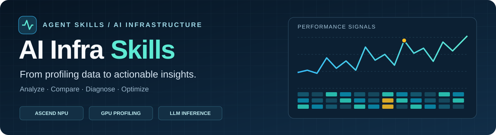
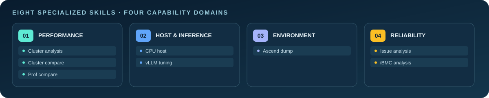
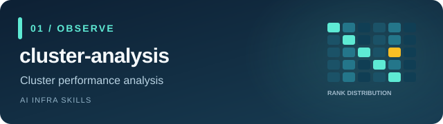
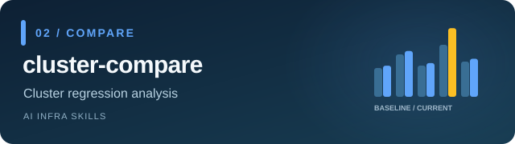
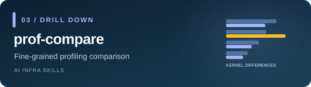
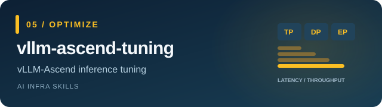
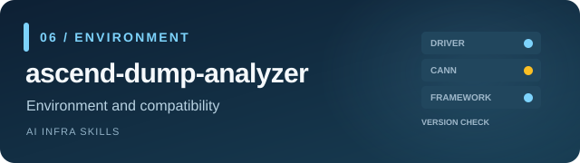

<div align="center">



<h1>AI Infra Skills</h1>
<p><b>AI 智能性能分析技能集</b></p>
<p>将性能专家的分析方法沉淀为 Agent 可执行、结果可回验的工作流。</p>

<a href="#skills"></a> <a href="#quick-start"></a> <a href="#reports"></a> <a href="README_EN.md"></a>

</div>

## 为什么选择 AI Infra Skills？

**从手工分析走向可复用的专家工作流。** 面向昇腾 AI 训练与推理，覆盖性能全景、双集群差异、跨平台单卡比对、Host 瓶颈、推理调优、环境配套、故障取证与硬件诊断。

- **自动化分析**：按 Skill 定义识别输入、运行工具、汇总数据和定位候选瓶颈。
- **逐层下钻**：从集群、Rank 与 Step，到算子、Kernel、Host 线程及日志证据。
- **结构化交付**：HTML / Markdown / Excel / JSON 等（按 Skill 和数据覆盖）。
- **经验复用**：明确分析口径、数据缺项和能力边界，便于复核和验证。



## Skills

**全部 8 个 Skill · 点击任意技能封面或按钮查看对应文档**

### 性能全景与差异归因

从单份 Prof 的全景分析到双集群比较，再到微观算子分析。三个 Skill 按问题独立选用，并非强制串行执行。

<table>
<tr>
<td width="50%" valign="top">
<a href="cluster-analysis/README.md"></a>
<h3>集群性能全景分析</h3>
<p><b>一份 Prof，找出训练或推理到底哪里慢。</b></p>
<ul><li>自动识别单卡、多卡与已有集群输出；支持 TEXT / DB 数据</li><li>分析计算、通信、Host 下发、慢 Rank、MoE 负载与泳道；23 个正式 recipe + 1 个扩展</li><li>自动比对通信占比最大/最小卡（有对应数据时），统一生成性能报告</li></ul>
<p><b>输入：</b>一份昇腾 Prof 或 cluster_analysis_output<br><b>交付：</b>performance_report.html；JSON / CSV / Excel 等（按数据覆盖）</p>
<p><a href="cluster-analysis/README.md"></a> &nbsp; <a href="cluster-analysis/SKILL.md"></a></p>
</td>
<td width="50%" valign="top">
<a href="cluster-compare/README.md"></a>
<h3>双集群性能差异归因</h3>
<p><b>两套集群，量化差异并解释性能劣化来源。</b></p>
<ul><li>拆解 Step、计算、通信、空闲耗时及差异贡献</li><li>Rank 级走势、通信算子差异 Top 10、通信矩阵与带宽双口径判定（有数据时）</li><li>生成中文 HTML / MD 报告，给出 P0/P1/P2 行动建议</li></ul>
<p><b>输入：</b>基准集群 A 与对比集群 B 的 Prof / 集群分析输出<br><b>交付：</b>cluster_compare_report.html / .md</p>
<p><a href="cluster-compare/README.md"></a> &nbsp; <a href="cluster-compare/SKILL.md"></a></p>
</td>
</tr>
<tr>
<td width="50%" valign="top">
<a href="prof-compare/README.md"></a>
<h3>NPU / GPU 单卡精细比对</h3>
<p><b>从总体差异下钻到具体算子、Kernel 与单次执行。</b></p>
<ul><li>支持 NPU vs GPU、NPU vs NPU 与调优前后比对</li><li>覆盖算子、模块、Kernel、通信、内存、Host API；有明细时展示 Host/Device Top 15</li><li>按数据可用性展示单次执行 47 项字段，输出中文 Excel 与交互 HTML</li></ul>
<p><b>输入：</b>两份单卡 Prof，或已有 compare XLSX<br><b>交付：</b>compare_analysis_report.html；中文 XLSX / JSON / CSV</p>
<p><a href="prof-compare/README.md"></a> &nbsp; <a href="prof-compare/SKILL.md"></a></p>
</td>
<td width="50%" valign="top">
<a href="cpu-host-performance/README.md"></a>
<h3>HostBound 与 CPU 瓶颈诊断</h3>
<p><b>设备利用率低或下发慢？检查 Host 是否拖慢业务。</b></p>
<ul><li>Linux ftrace 只读采集、离线分析；支持采集包、trace 文本及 Perfetto 等</li><li>分析调度等待、IRQ/SoftIRQ、CPU 频率、全核负载、资源压力和线程竞争证据</li><li>核对 NPU/NUMA 亲和性，生成可审阅绑核建议及配置；执行变更需批准</li></ul>
<p><b>输入：</b>CPU trace 采集包、ftrace/trace-cmd 或兼容 JSON<br><b>交付：</b>hostbound_report.html；report_data.json；绑核建议/配置</p>
<p><a href="cpu-host-performance/README.md"></a> &nbsp; <a href="cpu-host-performance/SKILL.md"></a></p>
</td>
</tr>
</table>

### 推理优化与基础设施诊断

从模型推理配置到环境、故障和服务器硬件，形成互补的 AI 基础设施诊断能力。

<table>
<tr>
<td width="50%" valign="top">
<a href="vllm-ascend-tuning/README.md"></a>
<h3>vLLM-Ascend 全链路推理调优</h3>
<p><b>面向低时延或高吞吐目标，系统性验证推理调优收益。</b></p>
<ul><li>Phase 0–11 工作流，基于 19 个模型基准 YAML 匹配起始配置（按独立文档）</li><li>覆盖 TP/DP/EP、编译、OS、CANN/HCCL、图模式、量化、投机解码、PD 分离</li><li>通过 vllm bench 验证 TTFT、TPOT、吞吐与配置收益</li></ul>
<p><b>输入：</b>模型、硬件、现有配置、量化及性能目标<br><b>交付：</b>YAML / 调优参数、启动配置、基准测试结果</p>
<p><a href="vllm-ascend-tuning/README.md"></a> &nbsp; <a href="vllm-ascend-tuning/SKILL.md"></a></p>
</td>
<td width="50%" valign="top">
<a href="ascend-dump-analyzer/README.md"></a>
<h3>昇腾环境体检与版本配套</h3>
<p><b>环境差异或升级配套不明？找出配置漂移与版本风险。</b></p>
<ul><li>采集系统、驱动、CANN、进程环境和网络等现场信息（按采集能力）</li><li>支持单环境健康分析、多环境比对及离线版本配套核对</li><li>报告标注证据、采集缺项与最少变更建议</li></ul>
<p><b>输入：</b>环境 dump JSON、目录或组件版本清单<br><b>交付：</b>HTML 环境分析 / 比对报告；Markdown 摘要</p>
<p><a href="ascend-dump-analyzer/README.md"></a> &nbsp; <a href="ascend-dump-analyzer/SKILL.md"></a></p>
</td>
</tr>
<tr>
<td width="50%" valign="top">
<a href="issue-analyzer/README.md"></a>
<h3>现网故障日志取证</h3>
<p><b>训练或推理报错、中断、hang：让故障判断有证据可回验。</b></p>
<ul><li>从 plog、slog、Host、Device、框架等日志分诊并提取关键错误</li><li>构建故障时间线，保留日志原文、来源文件和行号</li><li>区分候选根因并提供回验命令与处置建议；不替代性能分析或正式缺陷单</li></ul>
<p><b>输入：</b>日志目录 / 解包日志，以及故障现象与时间（可选）<br><b>交付：</b>Markdown 取证报告；关键错误摘要、时间线</p>
<p><a href="issue-analyzer/README.md"></a> &nbsp; <a href="issue-analyzer/SKILL.md"></a></p>
</td>
<td width="50%" valign="top">
<a href="ibmc-analyzer/README.md"></a>
<h3>服务器硬件健康诊断</h3>
<p><b>服务器告警、宕机或性能异常时，从 BMC 侧核查硬件。</b></p>
<ul><li>解析 iBMC dump_info、SEL、传感器、健康及配置日志</li><li>检查 MCE/PCIe、温度、BIOS 等硬件/配置风险（按日志可用性）</li><li>支持单机诊断与多机配置差异比对，形成结构化报告</li></ul>
<p><b>输入：</b>iBMC dump_info 目录或一键收集压缩包<br><b>交付：</b>HTML 诊断 / 比对报告；结构化 JSON</p>
<p><a href="ibmc-analyzer/README.md"></a> &nbsp; <a href="ibmc-analyzer/SKILL.md"></a></p>
</td>
</tr>
</table>

以上封面图为能力示意，并非实测数据或实际报告截图。

## Quick Start

**三步开始使用**

**01 · 获取技能**

```bash
git clone https://github.com/hu669293657/skills.git
cd skills
```

**02 · 选择 Skill**

让具备本地文件读取及命令执行权限的 Agent 读取对应目录下的 `SKILL.md`，按照定义执行；也可按所用 Agent 的安装机制导入完整 Skill 目录。没有统一安装器，依赖和兼容性以各自文档为准。

**03 · 提供数据和目标**

<details open>
<summary><b>示例：一份 Prof 性能分析</b></summary>

```text
使用 cluster-analysis 分析 ./prof_data，识别主要性能瓶颈和异常 Rank，提供数据证据、优化建议，并生成完整 HTML 报告。
```

</details>

<details>
<summary><b>展开其余 7 个 Skill 的示例提示词</b></summary>

**双集群性能差异归因 · cluster-compare**

```text
使用 cluster-compare 对比 ./baseline 与 ./current，以 baseline 为基准，分析劣化贡献、异常 Rank 和通信带宽，生成 HTML / MD 报告。
```

**NPU / GPU 单卡精细比对 · prof-compare**

```text
使用 prof-compare 对比 ./gpu_prof 与 ./npu_prof，以 GPU 为基准，定位总体差异、劣化 Top 算子及 Kernel，生成 HTML 和中文 Excel。
```

**HostBound 与 CPU 瓶颈诊断 · cpu-host-performance**

```text
使用 cpu-host-performance 分析 ./cpu_trace，检查调度、CPU 频率、IRQ、NUMA 与业务线程竞争，给出证据和绑核建议，不执行配置修改。
```

**vLLM-Ascend 全链路推理调优 · vllm-ascend-tuning**

```text
使用 vllm-ascend-tuning 检查当前推理配置，优化 TTFT、TPOT 和吞吐，请先提供调优计划及基准验证方案，不直接修改服务。
```

**昇腾环境体检与版本配套 · ascend-dump-analyzer**

```text
使用 ascend-dump-analyzer 分析 ./dump，核对环境配置和版本配套，列出配置漂移、证据与未采集项。
```

**现网故障日志取证 · issue-analyzer**

```text
使用 issue-analyzer 分析 ./logs，定位报错或中断，建立故障时间线，给出日志原文证据、候选根因和回验命令。
```

**服务器硬件健康诊断 · ibmc-analyzer**

```text
使用 ibmc-analyzer 分析 ./dump_info，核查服务器和 BMC 健康状态，列出异常证据及处置建议。
```

</details>

也可以独立运行 cluster-analysis（满足输入及 Python 依赖要求后）：

```bash
cd cluster-analysis
python scripts/run_workflow.py --input "/path/to/prof_data" --no-native
```

## Reports

**报告与交付**

- **[cluster-analysis](cluster-analysis/README.md)** — performance_report.html；JSON / CSV / Excel 等（按数据覆盖）
- **[cluster-compare](cluster-compare/README.md)** — cluster_compare_report.html / .md
- **[prof-compare](prof-compare/README.md)** — compare_analysis_report.html；中文 XLSX / JSON / CSV
- **[cpu-host-performance](cpu-host-performance/README.md)** — hostbound_report.html；report_data.json；绑核建议/配置
- **[vllm-ascend-tuning](vllm-ascend-tuning/README.md)** — YAML / 调优参数、启动配置、基准测试结果
- **[ascend-dump-analyzer](ascend-dump-analyzer/README.md)** — HTML 环境分析 / 比对报告；Markdown 摘要
- **[issue-analyzer](issue-analyzer/README.md)** — Markdown 取证报告；关键错误摘要、时间线
- **[ibmc-analyzer](ibmc-analyzer/README.md)** — HTML 诊断 / 比对报告；结构化 JSON

报告覆盖取决于输入与环境。公开脱敏 Demo 及可复现基准尚未发布；封面图不代表实际性能收益。

## 使用边界与反馈

单/双集群分析主要面向昇腾；跨 NPU/GPU 单卡比对由 prof-compare 提供。cluster-analysis 内置 fallback 有明确前置条件，不宣称与原生 CLI 全部能力等价。安装依赖、远程访问、绑核及生产配置变更前应核对权限、影响、审批和回滚方案。请勿公开敏感日志、Prof、客户信息或凭据。根目录尚无 LICENSE，再分发前请确认授权及第三方条款。

<div align="center">

<b>AI Infra Skills · 从性能数据到可行动的洞察</b>

<a href="https://github.com/hu669293657/skills/issues"></a> <a href="README_EN.md"></a>

欢迎 Star 支持项目。

</div>
