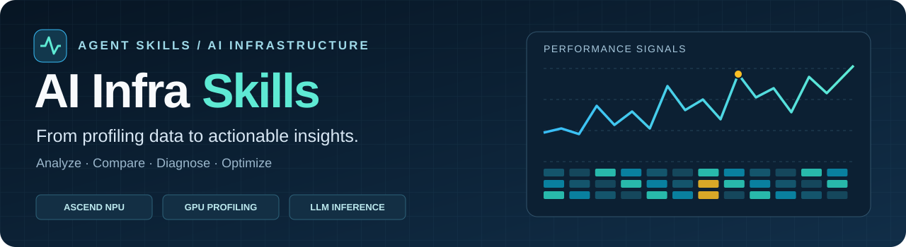
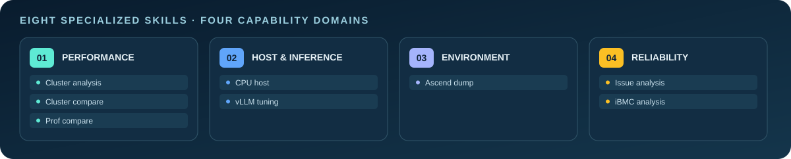

<div align="center">



# AI Infra Skills

**Agent-powered performance analysis for AI infrastructure**

Profiling · Regression attribution · Diagnostics · LLM inference optimization

[中文](README.md) · [Quick start](#quick-start) · [Skill catalog](#skill-catalog) · [Reports](#reports)

</div>

## Why AI Infra Skills?

Turn reusable performance engineering methods into agent-executable workflows. Provide profiling data, logs or configuration snapshots, and use a suitable skill to extract metrics, inspect evidence, attribute performance differences and generate reports. This repository primarily targets Ascend training and inference; single-card NPU/GPU comparison is supported by prof-compare.



The diagram represents available capabilities, not a mandatory execution sequence.

## Featured skills

### [cluster-analysis](cluster-analysis/README.md) — Cluster performance analysis

One profiling dataset; identify slow ranks and compute, communication and host bottlenecks.

### [cluster-compare](cluster-compare/README.md) — Cluster regression analysis

Compare two clusters, attribute regressions and inspect bandwidth and rank differences.

### [prof-compare](prof-compare/README.md) — Fine-grained profiling comparison

Compare NPU/GPU or NPU/NPU traces, drill down to operators, kernels, shapes and individual executions.

- **cluster-analysis:** 23 registered recipes and one extension; unified HTML report according to available evidence. Built-in fallback has prerequisites and is not claimed to be fully equivalent to native CLI.
- **cluster-compare:** step and rank comparison, compute/communication/idle attribution and bandwidth checks.
- **prof-compare:** host/device top 15 and 47 execution fields when raw details are available.

## Quick start

```bash
git clone https://github.com/hu669293657/skills.git
cd skills
```

Ask an agent with local file and command execution access to read the chosen skill's `SKILL.md` and follow its workflow. Alternatively, import the complete skill directory according to your agent's installation instructions. There is no universal installer; dependencies and supported environments vary by skill.

```text
Use cluster-analysis to analyze ./prof_data, identify major bottlenecks
and anomalous ranks, show supporting evidence and generate an HTML report.
```

```text
Use cluster-compare to compare ./baseline with ./current, attribute
performance regressions and generate HTML and Markdown reports.
```

```text
Use prof-compare to compare ./gpu_prof with ./npu_prof, using GPU as
the baseline. Identify hot operators and generate HTML and Excel reports.
```

For standalone cluster-analysis (after reviewing its prerequisites):

```bash
cd cluster-analysis
python scripts/run_workflow.py --input "/path/to/prof_data" --no-native
```

## Skill catalog

| Skill | Purpose |
| :--- | :--- |
| [cluster-analysis](cluster-analysis/README.md) | One profiling dataset; identify slow ranks and compute, communication and host bottlenecks. |
| [cluster-compare](cluster-compare/README.md) | Compare two clusters, attribute regressions and inspect bandwidth and rank differences. |
| [prof-compare](prof-compare/README.md) | Compare NPU/GPU or NPU/NPU traces, drill down to operators, kernels, shapes and individual executions. |
| [cpu-host-performance](cpu-host-performance/README.md) | Inspect scheduling latency, CPU frequency, IRQ, NUMA and binding proposals. |
| [vllm-ascend-tuning](vllm-ascend-tuning/README.md) | Optimize parallelism, compilation, quantization, latency and throughput with benchmarks. |
| [ascend-dump-analyzer](ascend-dump-analyzer/README.md) | Inspect environment snapshots, configuration drift and component compatibility. |
| [issue-analyzer](issue-analyzer/README.md) | Triage errors, interruptions and hangs with log evidence and validation steps. |
| [ibmc-analyzer](ibmc-analyzer/README.md) | Inspect iBMC logs, hardware health and multi-node configuration differences. |

## Reports

- Cluster analysis: `performance_report.html`
- Cluster comparison: `cluster_compare_report.html` and Markdown
- Profiling comparison: `compare_analysis_report.html`, Chinese Excel, JSON and CSV
- Additional diagnosis and tuning outputs are documented in each skill.

Public demo reports and reproducible benchmarks have not yet been published. Coverage depends on available profiling evidence and the actual runtime environment.

## Usage notes

Read the skill-specific prerequisites and data requirements. Obtain approval before installing dependencies, changing production settings or performing remote operations. Never publish sensitive customer logs, traces, credentials or reports. No root-level LICENSE is currently provided; verify redistribution rights and third-party terms.

Feedback is welcome via [Issues](https://github.com/hu669293657/skills/issues).

If the repository helps your work, consider starring it.
