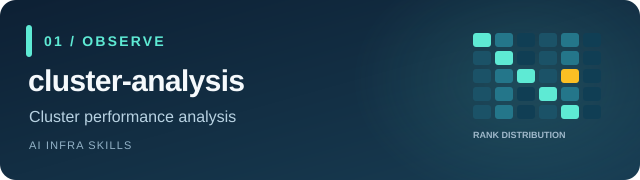
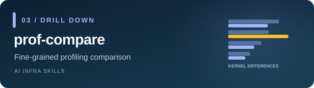
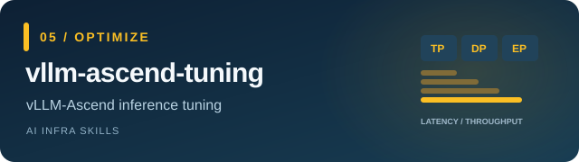
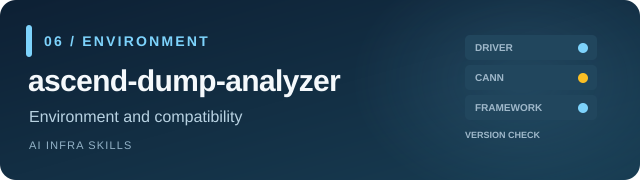

<div align="center">


<h1>AI Infra Skills</h1>
<p><b>Agent-powered performance analysis for AI infrastructure</b></p>
<p>Turn performance engineering expertise into agent-executable, evidence-backed workflows.</p>

<a href="#skills"></a> <a href="#quick-start"></a> <a href="#reports"></a> <a href="README.md"></a>

</div>

## Why AI Infra Skills?

**From manual investigation to reusable expert workflows.** Designed primarily for Ascend training and inference, with NPU/GPU single-card comparisons, host analysis, inference tuning, environment checks, incident investigation and hardware diagnosis.


## Skills

**All eight skills. Click any cover or button to open its documentation.**

### Performance analysis and attribution

Select the appropriate skill for the input and question. These are complementary capabilities, not a mandatory execution sequence.

<table>
<tr>
<td width="50%" valign="top">
<a href="cluster-analysis/README.md"></a>
<h3>Cluster performance analysis</h3>
<p><b>Identify bottlenecks in one Ascend profiling dataset.</b></p>
<ul><li>Single-card, multi-card and existing cluster outputs; TEXT / DB</li><li>Compute, communication, host, rank, MoE and timeline analysis; 23 registered recipes + one extension</li><li>Compare ranks with maximum/minimum communication share when evidence is available</li></ul>
<p><b>Input：</b>One Ascend Prof dataset or cluster_analysis_output<br><b>Output：</b>performance_report.html; JSON / CSV / Excel as available</p>
<p><a href="cluster-analysis/README.md"></a> &nbsp; <a href="cluster-analysis/SKILL.md"></a></p>
</td>
<td width="50%" valign="top">
<a href="cluster-compare/README.md"></a>
<h3>Cluster regression analysis</h3>
<p><b>Compare two Ascend clusters and attribute regressions.</b></p>
<ul><li>Step, compute, communication and idle attribution</li><li>Rank trends, communication top differences, matrix and bandwidth checks when available</li><li>Chinese HTML / Markdown and prioritized actions</li></ul>
<p><b>Input：</b>Baseline and comparison cluster profiling or summaries<br><b>Output：</b>cluster_compare_report.html / .md</p>
<p><a href="cluster-compare/README.md"></a> &nbsp; <a href="cluster-compare/SKILL.md"></a></p>
</td>
</tr>
<tr>
<td width="50%" valign="top">
<a href="prof-compare/README.md"></a>
<h3>Fine-grained profiling comparison</h3>
<p><b>Drill down from overall differences to operators and kernels.</b></p>
<ul><li>NPU vs GPU, NPU vs NPU and before/after analysis</li><li>Operators, modules, kernels, communication, memory and Host API; Top 15 when available</li><li>Up to 47 execution fields subject to data coverage; Chinese Excel and HTML</li></ul>
<p><b>Input：</b>Two single-card Prof datasets or compare XLSX<br><b>Output：</b>compare_analysis_report.html; Chinese XLSX / JSON / CSV</p>
<p><a href="prof-compare/README.md"></a> &nbsp; <a href="prof-compare/SKILL.md"></a></p>
</td>
<td width="50%" valign="top">
<a href="cpu-host-performance/README.md"></a>
<h3>Host and CPU bottleneck diagnosis</h3>
<p><b>Investigate host-side risks when device execution stalls.</b></p>
<ul><li>Read-only Linux ftrace capture and offline analysis; multiple trace formats</li><li>Scheduling, IRQ/SoftIRQ, frequency, utilization, resource pressure and contention evidence</li><li>NPU/NUMA affinity and reviewable binding proposals; changes require approval</li></ul>
<p><b>Input：</b>CPU capture bundle, ftrace/trace-cmd or supported JSON<br><b>Output：</b>hostbound_report.html; report_data.json; binding proposals/config</p>
<p><a href="cpu-host-performance/README.md"></a> &nbsp; <a href="cpu-host-performance/SKILL.md"></a></p>
</td>
</tr>
</table>

### Inference and infrastructure diagnostics

<table>
<tr>
<td width="50%" valign="top">
<a href="vllm-ascend-tuning/README.md"></a>
<h3>vLLM-Ascend inference tuning</h3>
<p><b>Tune inference for latency or throughput with benchmarks.</b></p>
<ul><li>Phase 0–11 workflow; 19 model baseline YAMLs per skill documentation</li><li>Parallelism, compilation, OS, CANN/HCCL, graph mode, quantization, speculative decoding, PD disaggregation</li><li>Validate TTFT, TPOT and throughput with vllm bench</li></ul>
<p><b>Input：</b>Model, hardware, config, quantization and target<br><b>Output：</b>YAML / tuning parameters, launch configuration, benchmark results</p>
<p><a href="vllm-ascend-tuning/README.md"></a> &nbsp; <a href="vllm-ascend-tuning/SKILL.md"></a></p>
</td>
<td width="50%" valign="top">
<a href="ascend-dump-analyzer/README.md"></a>
<h3>Environment and compatibility</h3>
<p><b>Identify configuration drift and component compatibility risks.</b></p>
<ul><li>Capture system, driver, CANN, process and network information as available</li><li>Single or multiple snapshot analysis and offline compatibility checks</li><li>Evidence, missing fields and minimal-change recommendations</li></ul>
<p><b>Input：</b>Environment dump JSON, directory or component inventory<br><b>Output：</b>HTML environment/comparison reports and Markdown summary</p>
<p><a href="ascend-dump-analyzer/README.md"></a> &nbsp; <a href="ascend-dump-analyzer/SKILL.md"></a></p>
</td>
</tr>
<tr>
<td width="50%" valign="top">
<a href="issue-analyzer/README.md"></a>
<h3>Incident log investigation</h3>
<p><b>Investigate failures, interruptions and hangs with log evidence.</b></p>
<ul><li>Triage plog, slog, host, device and framework logs</li><li>Build timelines with original log excerpts, file and line references</li><li>Identify candidate causes, validation commands and mitigation; not a profiling or defect-ticket replacement</li></ul>
<p><b>Input：</b>Log directory / unpacked bundle, optional symptoms and time<br><b>Output：</b>Markdown evidence report, error summary and timeline</p>
<p><a href="issue-analyzer/README.md"></a> &nbsp; <a href="issue-analyzer/SKILL.md"></a></p>
</td>
<td width="50%" valign="top">
<a href="ibmc-analyzer/README.md"></a>
<h3>Server hardware health diagnosis</h3>
<p><b>Inspect hardware-side evidence after alerts or server issues.</b></p>
<ul><li>Parse iBMC dump_info, SEL, sensor, health and configuration logs</li><li>Inspect MCE/PCIe, temperature, BIOS and other evidence when available</li><li>Single-server diagnosis and multi-node comparison with structured reports</li></ul>
<p><b>Input：</b>iBMC dump_info directory or collection archive<br><b>Output：</b>HTML diagnosis/comparison reports; structured JSON</p>
<p><a href="ibmc-analyzer/README.md"></a> &nbsp; <a href="ibmc-analyzer/SKILL.md"></a></p>
</td>
</tr>
</table>

Cover artwork illustrates capabilities, not measured data or report screenshots.

## Quick Start

```bash
git clone https://github.com/hu669293657/skills.git
cd skills
```

Use an agent with local file and command execution access. Ask it to read the selected skill's `SKILL.md` and follow its workflow, or import the complete skill directory using the agent's own installation mechanism. There is no universal installer. Check skill-specific prerequisites and permissions.

```text
Use cluster-analysis to analyze ./prof_data, identify major bottlenecks
and anomalous ranks, provide evidence and generate an HTML report.
```

```text
Use cluster-compare to compare ./baseline with ./current, attribute
performance regressions and generate HTML and Markdown reports.
```

```text
Use prof-compare to compare ./gpu_prof with ./npu_prof, using GPU as
the baseline. Identify hot operators and generate HTML and Excel reports.
```

For standalone cluster-analysis (after checking prerequisites):

```bash
cd cluster-analysis
python scripts/run_workflow.py --input "/path/to/prof_data" --no-native
```

## Reports

- **[cluster-analysis](cluster-analysis/README.md)** — performance_report.html; JSON / CSV / Excel as available
- **[cluster-compare](cluster-compare/README.md)** — cluster_compare_report.html / .md
- **[prof-compare](prof-compare/README.md)** — compare_analysis_report.html; Chinese XLSX / JSON / CSV
- **[cpu-host-performance](cpu-host-performance/README.md)** — hostbound_report.html; report_data.json; binding proposals/config
- **[vllm-ascend-tuning](vllm-ascend-tuning/README.md)** — YAML / tuning parameters, launch configuration, benchmark results
- **[ascend-dump-analyzer](ascend-dump-analyzer/README.md)** — HTML environment/comparison reports and Markdown summary
- **[issue-analyzer](issue-analyzer/README.md)** — Markdown evidence report, error summary and timeline
- **[ibmc-analyzer](ibmc-analyzer/README.md)** — HTML diagnosis/comparison reports; structured JSON

Public sanitized demo reports and reproducible benchmarks have not been published. Actual coverage depends on data and runtime environment. The built-in cluster-analysis fallback has prerequisites and is not claimed to be fully equivalent to native CLI.

Obtain approval for dependency installation, remote operations, CPU binding or production configuration changes. Never publish sensitive logs, customer data or credentials. There is no root-level LICENSE at present; check redistribution rights and third-party terms.

<div align="center">

<a href="https://github.com/hu669293657/skills/issues"></a> <a href="README.md"></a>

If this project helps your work, consider starring it.

</div>
