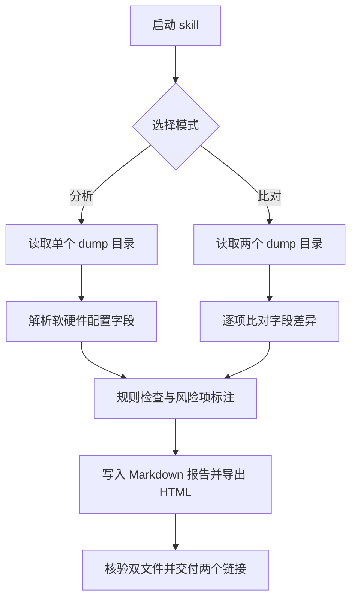

# ascend-dump-analyzer（昇腾 NPU 环境信息采集与分析）

采集、分析、比对昇腾 NPU 服务器环境信息（dump），用于部署前环境体检、多环境一致性核查与故障排查前的环境基线确认。

## 应用场景

- 部署训练/推理前，批量体检客户环境的软硬件配置（NPU 型号/驱动/CANN/固件/OS 等）。
- 怀疑环境差异导致问题时，对比两台/多台机器（如好机 vs 坏机）的配置漂移。
- 故障排查第一步：确认现场环境是否符合软件配套要求。
- 定期巡检集群环境，归档环境基线。

## 解决什么问题

- 现场环境信息零散、版本多，人工逐条收集慢且易漏：本 skill 提供零依赖采集脚本，一键生成结构化 dump。
- dump JSON 字段庞大难读：自动解析为人类可读的结构化分析结论。
- 两套环境"哪里不一样"难定位：自动逐项比对并高亮差异项（配置漂移检测）。

## 需要什么输入（如何获取）

| 输入 | 说明 | 获取方式 |
|------|------|----------|
| dump 目录 / dump JSON | 机器环境信息的结构化采集结果 | 在目标服务器上运行本 skill 自带的 `msprechecker_dump.py`（纯 Python 标准库、零依赖），即可在当前目录生成 dump JSON；将整个 dump 目录下载/拷贝到分析机即可 |
| 第二个 dump 目录（可选） | 比对模式所需的对照环境 dump | 用同一脚本在另一台机器上采集一份即可 |

无需安装任何额外依赖；若已有历史 dump 文件，直接提供路径即可。

固定环境快照示例。替换为本次可见的真实 PID，跨节点沿用相同角色名。需要保存 rank table 时追加 `--rank-table-path <路径> --scene mindie`，也可按实际格式选择 `vllm`。

```bash
python3 msprechecker_dump.py --filter --no-probes \
  --target launcher=1234 --target worker-0=2345 -o snapshot.json
```

1.2 扩充了版本清单、逐卡版本与拓扑、目标进程环境与加载库、目标 cgroup、路由规则和 rank table 证据。分别在宿主机和业务容器内采集，保留视图来源。采集解释器的包清单和业务进程的实际加载库分别记录。

## 输出成果

- 分析模式：默认同时保存 **Markdown（.md）与 HTML（.html）分析报告**，包含软硬件清单、版本配套核验、风险与证据限制。
- 比对模式：默认同时保存 **Markdown 与 HTML 差异报告**，列出相同项、差异项、仅一方存在项与未覆盖输入。
- “使用这个 skill 帮我分析这个日志”即触发双报告，不需要另说“生成报告”。默认同目录同名，使用用户指定目录或当前工作区的 `outputs/`，最终交付两个文件链接。
- 输入损坏、证据不足、未发现异常或零差异时仍生成报告，并明确限制；只有用户明确要求其他格式/不要文件时覆盖默认行为。
- 每次分析或比对**必须套用对应模板**。读取[单份分析模板](references/template_single_dump.md)或[多份比对模板](references/template_comparison.md)，填充实际观测。用 `render_report.py <报告.md> --template single` 或 `--template comparison` 导出，并以同一模板模式加 `--check` 验证章节与文件同步。

## 流程图



## 使用样例提示词

```text
# 分析模式
使用 ascend-dump-analyzer 分析 D:\dumps\hostA\ 目录下的 dump 信息

# 简短日志请求：内容为 dump JSON 即可，自动交付 MD + HTML
使用这个 skill 帮我分析这个日志：D:\dumps\environment.log

# 现场采集（在目标服务器上）
用 ascend-dump-analyzer 的采集脚本在这台服务器上收集环境 dump

# 比对模式
用 ascend-dump-analyzer 对比 D:\dumps\good\ 和 D:\dumps\bad\ 两个 dump 的配置差异
```
